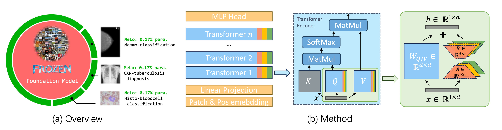

# LoRA-ViT

Low-Rank Adaptation for Vision Transformers. Apply LoRA to any ViT with a single wrapper.



> **On Apple Silicon?** Check out [mlx-vit-tune](https://github.com/JamesQFreeman/mlx-vit-tune) — native MLX fine-tuning for ViT with LoRA and full FT, gradient checkpointing, and an Unsloth-like API. 2-5x faster than PyTorch CPU on the same chip.

## Links

<div align="center">
    <a href="https://absterzhu.github.io/melo.github.io/" class="button"><b>[Homepage]</b></a> &nbsp;&nbsp;&nbsp;&nbsp;
    <a href="https://arxiv.org/abs/2311.08236" class="button"><b>[arXiv]</b></a> &nbsp;&nbsp;&nbsp;&nbsp;
    <a href="https://github.com/JamesQFreeman/mlx-vit-tune" class="button"><b>[MLX Version]</b></a> &nbsp;&nbsp;&nbsp;&nbsp;
</div>

## Features

- [x] LoRA for `timm` Vision Transformers
- [x] LoRA for `lukemelas/PyTorch-Pretrained-ViT`
- [x] DeepLab segmentation support
- [x] Multi-LoRA support
- [x] Save / load adapters via `safetensors`

## Installation

```bash
git clone https://github.com/JamesQFreeman/LoRA-ViT.git
pip install torch timm safetensors
```

Requires `torch>=1.10.0`.

## Usage

### With timm

```python
import timm
import torch
from lora import LoRA_ViT_timm

img = torch.randn(2, 3, 224, 224)
model = timm.create_model('vit_base_patch16_224', pretrained=True)
lora_vit = LoRA_ViT_timm(vit_model=model, r=4, alpha=4, num_classes=10)
pred = lora_vit(img)
print(pred.shape)
```

### With PyTorch-Pretrained-ViT

```python
from base_vit import ViT
import torch
from lora import LoRA_ViT

model = ViT('B_16_imagenet1k')
model.load_state_dict(torch.load('B_16_imagenet1k.pth'))

# 86M params → only 147K trainable with LoRA
lora_model = LoRA_ViT(model, r=4, alpha=4, num_classes=10)
num_params = sum(p.numel() for p in lora_model.parameters() if p.requires_grad)
print(f"trainable parameters: {num_params}")  # 147456
```

### Segmentation (DeepLabV3)

```python
model = ViT('B_16_imagenet1k')
model.load_state_dict(torch.load('B_16_imagenet1k.pth'))
lora_model = LoRA_ViT(model, r=4, alpha=4)
seg_lora_model = SegWrapForViT(vit_model=lora_model, image_size=384,
                               patches=16, dim=768, n_classes=10)
```

### Save and Load

```python
lora_model.save_lora_parameters('mytask.lora.safetensors')
lora_model.load_lora_parameters('mytask.lora.safetensors')
```

## Citation

```bibtex
@misc{zhu2023melo,
      title={MeLo: Low-rank Adaptation is Better than Fine-tuning for Medical Image Diagnosis}, 
      author={Yitao Zhu and Zhenrong Shen and Zihao Zhao and Sheng Wang and Xin Wang and Xiangyu Zhao and Dinggang Shen and Qian Wang},
      year={2023},
      eprint={2311.08236},
      archivePrefix={arXiv},
      primaryClass={cs.CV}
}
```

## Credit

ViT code and ImageNet pretrained weights from `lukemelas/PyTorch-Pretrained-ViT`.
